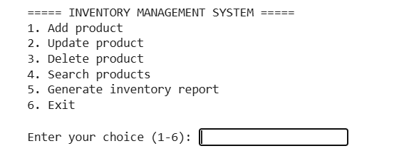
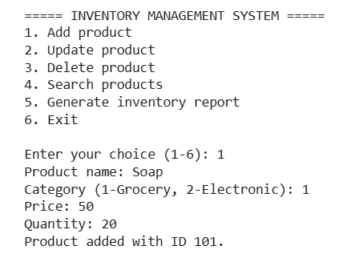
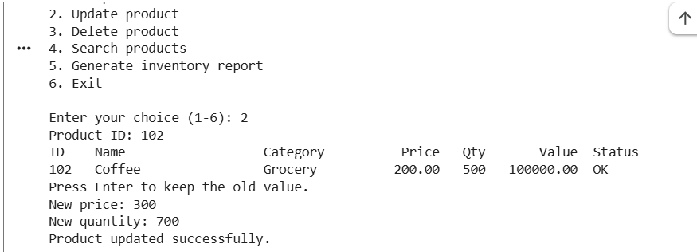
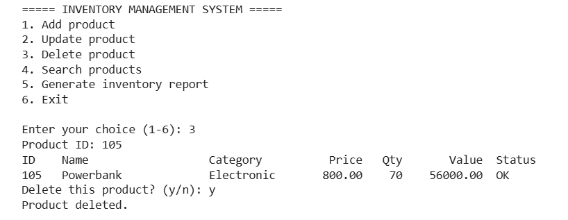
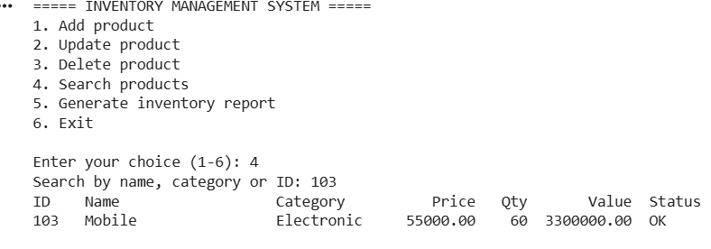
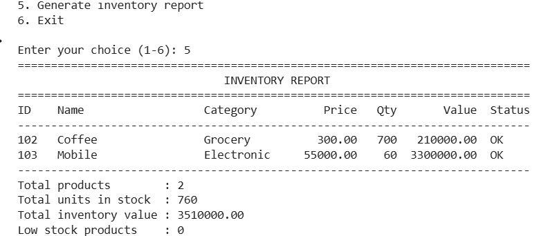
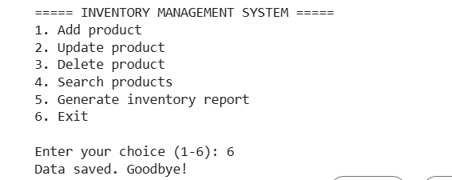

# Inventory Management System

A simple console-based Inventory Management System written in Python. It is built using Object-Oriented Programming (OOP) concepts and saves product data in a CSV file and the inventory report in a text file.

## What the project does

This project helps a shop or store manage its products. A user can add new products, update the price or quantity of a product, delete a product, search for products, and generate an inventory report that shows the stock, the total value, and the products that are running low. All data is saved in files, so nothing is lost when the program is closed.

## How the project works

1. When the program starts, it loads the saved products from `products.csv`. If the file does not exist, it starts with an empty inventory.
2. A menu is shown and the user selects an option (1 to 6).
3. Each product has a unique ID (starting from 101), a name, a category (Grocery or Electronic), a price, and a quantity.
4. The value of a product's stock is calculated as price x quantity.
5. Each category has its own low stock limit: a Grocery product is marked **LOW STOCK** at 20 units or fewer, and an Electronic product at 5 units or fewer.
6. While updating a product, the user can press Enter to keep the old price or quantity.
7. Before a product is deleted, the program asks for confirmation.
8. The inventory report shows all products, the total number of units, the total inventory value, and the list of low stock products. It is displayed on the screen and also saved in `inventory_report.txt`.
9. After every change, the product data is saved to `products.csv` automatically.
10. Invalid input (wrong product ID, empty name, negative price or quantity, file errors) is handled with exception handling, so the program does not crash.

## How to run the project

**Requirements:** Python 3.8 or above. No extra libraries are needed.

**On your computer:**

```
python inventory_management_system.py
```

**On Google Colab:**

1. Paste the code into a cell and run it.
2. Use the menu by typing a number and pressing Enter.
3. Choose option 6 to exit and save. The `products.csv` and `inventory_report.txt` files will be created in the Colab files panel.

## Classes used

| Class | Type | Purpose |
|---|---|---|
| `InventoryError` | Custom exception | Raised when an action cannot be completed (product not found, invalid category, etc.) |
| `Product` | Abstract base class (`abc`) | Defines the common structure and actions for all products, with private attributes and abstract methods `category()` and `low_stock_limit()` |
| `GroceryProduct` | Derived class | Inherits from `Product`. Low stock limit is 20 units |
| `ElectronicProduct` | Derived class | Inherits from `Product`. Low stock limit is 5 units |
| `Inventory` | Manager class | Stores all products and handles adding, updating, deleting, searching, generating reports, and saving data |

## Main features implemented

- **Add products:** adds a Grocery or Electronic product with an automatic ID
- **Update products:** changes the price, the quantity, or both
- **Delete products:** removes a product after confirmation
- **Search products:** finds products by name, category, or ID (not case-sensitive)
- **Generate inventory reports:** shows all products, total units, total value, and low stock products, and saves the report to a text file
- **Save data:** reads and writes data using `products.csv` and `inventory_report.txt`

## OOP concepts demonstrated

| Concept | Where it is used |
|---|---|
| Classes & Objects | `Product`, `GroceryProduct`, `ElectronicProduct`, `Inventory` |
| Encapsulation | Private attributes (`__name`, `__price`, `__quantity`) with getters and setters using `@property` |
| Inheritance | `GroceryProduct` and `ElectronicProduct` inherit from `Product` |
| Abstraction | `Product` is an abstract class using the `abc` module |
| File Handling | Data is read from and written to `products.csv` (CSV) and `inventory_report.txt` (text) |
| Exception Handling | `InventoryError`, `FileNotFoundError`, `ValueError`, and `OSError` are handled |

## Program output (Screenshots)

### 1. Main menu
The program shows the menu and asks the user to enter a choice.



### 2. Add product (Choice 1)
The user enters the name, category, price, and quantity. A product ID is generated.



### 3. Update product (Choice 2)
The user changes the price or quantity of a product. Pressing Enter keeps the old value.



### 4. Delete product (Choice 3)
The program asks for confirmation and then removes the product.



### 5. Search products (Choice 4)
The user searches by name, category, or ID, and the matching products are displayed.



### 6. Inventory report (Choice 5)
The report shows all products, total units, total value, and low stock products.



### 7. Exit and save data (Choice 6)
The data is saved and the program closes.



## Project files

```
inventory_management_system/
├── inventory_management_system.py   # main program
├── products.csv                     # saved product records
├── inventory_report.txt             # generated inventory report
├── screenshots/                     # output screenshots
└── README.md                        # project documentation
```
